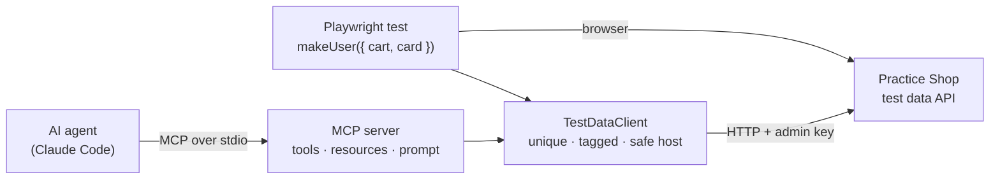

# test-data-mcp

[](https://github.com/nitesh00747/test-data-mcp/actions/workflows/ci.yml)
[](https://modelcontextprotocol.io)
[](https://playwright.dev)

**Fresh, isolated test data on request, for Playwright tests and AI agents.**

Ask for *"a user with 2 items in the cart and an expired card"* and get one in milliseconds, built
through an API instead of clicking through the UI, with its own unique login and automatic cleanup.

A learning project: how an MCP server works inside, and why test data is the quiet cause of slow and
flaky UI tests. It includes its own small demo shop to test against, so everything runs locally.

## How it fits together



One library builds the data. Tests call it directly through fixtures; agents call it through the MCP
server. Either way the data is built the same way.

## What it proves

Measured in this repo on one local run (`e2e/why-test-data.spec.ts`); your timings will differ:

| Experiment | Result |
|---|---|
| Build a 3-item cart through the API vs the UI | **3 ms vs 447 ms** |
| 14 UI tests × 3 repeats on 4 parallel workers, one fresh user each | **42 / 42 passed**, 0 users left behind |
| The same cart tests sharing one login | **4 / 4 failed**: they saw each other's items |

## Quick start

```bash
npm install
npx playwright install chromium   # once
npm test                          # library + MCP server tests, then the UI tests
```

Playwright starts the shop for the UI tests itself. To explore by hand: `npm run app`, then open
http://127.0.0.1:3100 and log in as `demo` / `demo123`.

### Use it from Claude Code

The repo's `.mcp.json` registers the server. Start the shop (`npm run app`), open Claude Code in the
repo, approve the `test-data` server, then try:

> *Create a test user with a backpack and two coffee mugs in the cart and an expired card, then tell me what happens at checkout.*

The agent calls `create_test_user`, logs in with the credentials it got back, and can clean up with
`cleanup_test_data`. To poke at the server without an agent, run `npm run inspect` (the official MCP
Inspector).

## In a test

```ts
import { test, expect } from './fixtures.ts';

test('an expired card is declined and the cart is kept', async ({ page, makeUser, loginAs }) => {
  const shopper = await makeUser({ card: 'expired', cart: ['t-shirt'] }); // ~3 ms, through the API
  await loginAs(shopper);
  await page.getByTestId('nav-cart').click();
  await page.getByTestId('checkout').click();
  await expect(page.getByTestId('error')).toHaveText('Payment declined: card ending 4242 has expired.');
}); // shopper is deleted automatically, pass or fail
```

## What the MCP server offers

| Kind | Name | What it does |
|---|---|---|
| Tool | `create_test_user` | A unique user, optionally `locked`, with an `expired` card, a cart and past orders. Returns the login |
| Tool | `add_to_cart`, `create_order` | Add to an existing test user |
| Tool | `get_test_user`, `list_test_data` | Read-only lookups |
| Tool | `cleanup_test_data` | Delete this session's data, all your agent sessions' data, or abandoned leftovers (unused for an hour or more). Never another run's or a teammate's data in use. Marked destructive |
| Resource | `test-data://products`, `test-data://guide` | The product catalogue, and the rules for using test data |
| Prompt | `test_with_fresh_data` | "Write a Playwright test for *scenario*", with the right setup steps |

## Safety rules built in

- **Unique:** every username is `label_run_counter`, so parallel tests never share data.
- **Tagged:** everything created carries `test-data`, `run:<id>` and `owner:<who>` (plus `group:<id>`
  for a whole Playwright run). Cleanup deletes only its own tags, so it never touches another run's
  data, real users or seed users. Teardown removes only this run's leftovers.
- **Enforced by the app too:** everything the test data API creates is tagged `test-data`, and it
  refuses to delete any user without that tag. Logins expire after 8 hours.
- **Per person and per run:** agent data is owned by `mcp-<your username>`, each Playwright run gets
  a fresh group id, and "abandoned" means unused, not just old.
- **Safe host:** it refuses any host except localhost unless you add it to `TEST_DATA_ALLOWED_HOSTS`,
  and never follows redirects, so the admin key can't be sent anywhere else.
- **Admin key:** the test data API needs the `x-admin-key` header (`ADMIN_KEY`). It switches itself off
  if the app listens beyond localhost with the public default key, or with `ENABLE_TEST_DATA_API=false`.
- **Passwords:** throwaway, and deleted with the user. Set `TEST_DATA_HIDE_PASSWORDS=true` to keep
  them out of the agent's chat (structured result only).

## Project layout

| Path | What |
|---|---|
| `demo-app/` | Practice Shop: UI, customer API and test data API (Node's `http`, no framework) |
| `src/core/test-data.ts` | The test data library: recipes, unique names, tags, cleanup, host check |
| `src/mcp/server.ts` | The MCP server: tools, resources and a prompt over stdio |
| `e2e/` | Playwright fixtures (`user`, `makeUser`, `loginAs`) and UI tests |
| `test/` | Library tests, and MCP tests that drive the server with the official MCP client |

**Learn more:** [docs/HOW-IT-WORKS.md](docs/HOW-IT-WORKS.md) walks through a real MCP exchange, the
design choices, and exercises to try.
